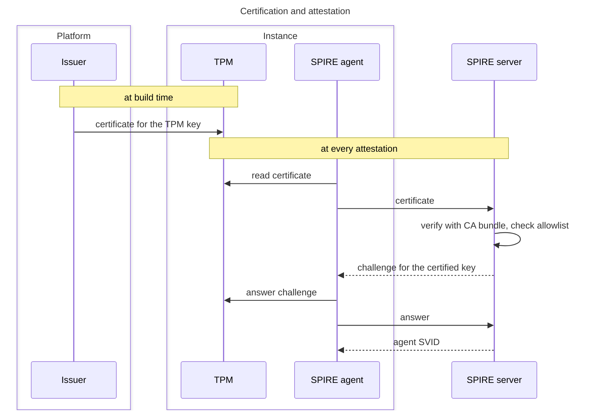
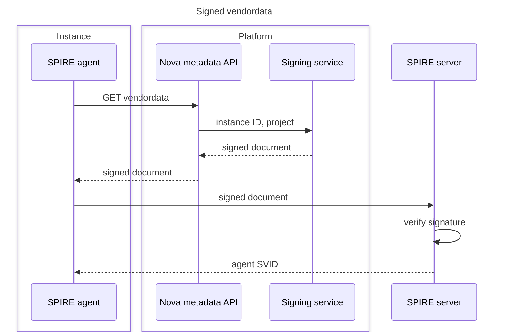
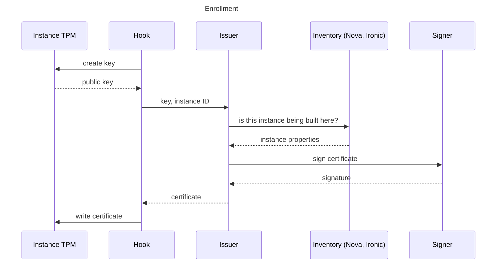
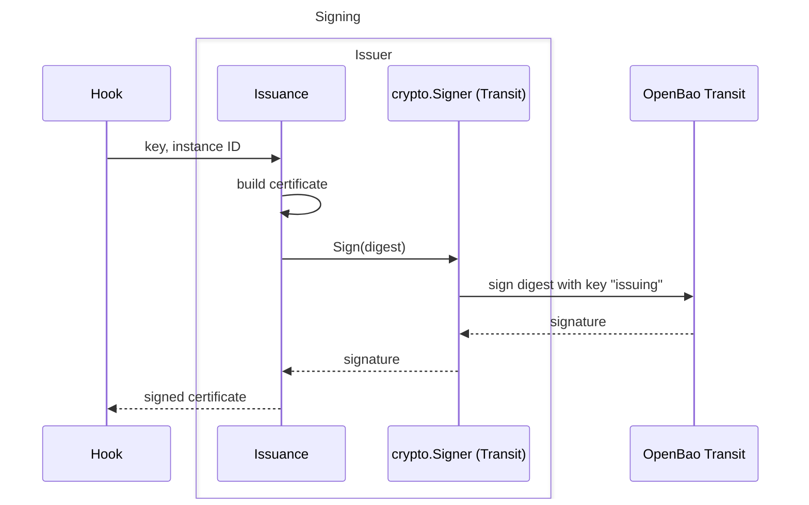
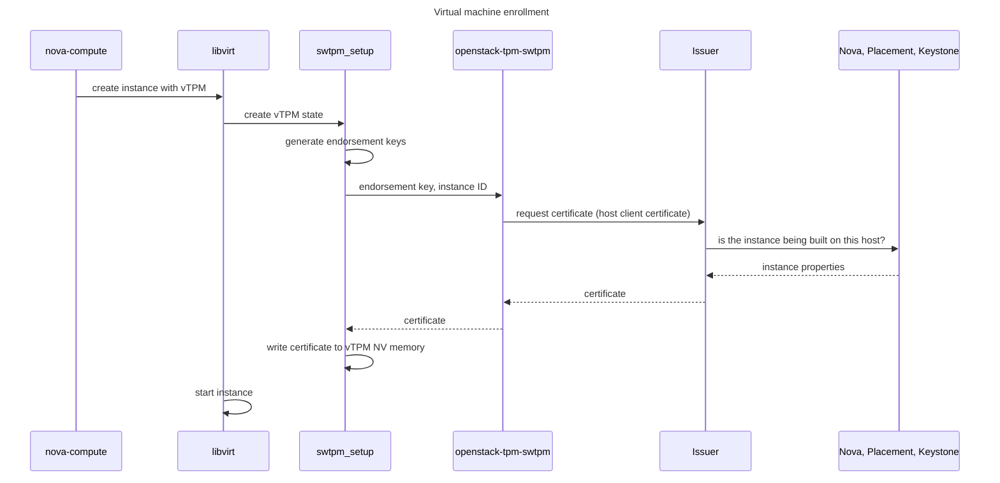
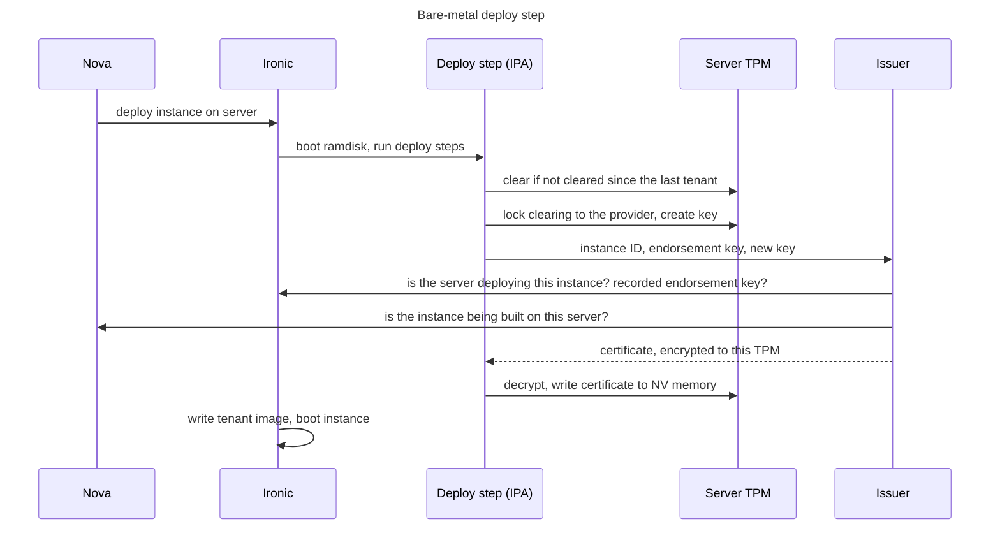
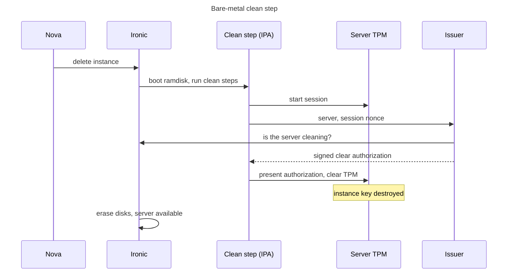

# spire-openstack-tpm

This project is a reference proof of concept for zero-touch SPIRE node attestation on OpenStack, for both virtual machines and bare-metal servers to solve the secret zero problem.

The platform certifies a key for each instance that requests a Trusted Platform Module (TPM) with a certificate that identifies the instance, whether the TPM is the vTPM that libvirt attaches to a virtual machine or the physical TPM of a server that Ironic deploys.

The platform issues certificates and stays off the attestation path. A central team or individual tenants can run their own SPIRE server and verify the certificates with the platform's CA bundle.



This project contains:

- This write-up
- Enrollment service (issuer): [`cmd/openstack-tpm-issuer`](cmd/openstack-tpm-issuer), [`internal/issuer`](internal/issuer)
- Hook for virtual machines, called by `swtpm_setup`: [`cmd/openstack-tpm-swtpm`](cmd/openstack-tpm-swtpm), [`deploy/hypervisor`](deploy/hypervisor)
- Deploy and clean steps for bare metal, run by Ironic: [`cmd/openstack-tpm-ipa`](cmd/openstack-tpm-ipa), [`deploy/ironic`](deploy/ironic)
- SPIRE server plugin: [`cmd/openstack-tpm-spire-server`](cmd/openstack-tpm-spire-server), [`internal/nodeattestor`](internal/nodeattestor)
- SPIRE agent plugin: [`cmd/openstack-tpm-spire-agent`](cmd/openstack-tpm-spire-agent)
- Certificate format and key templates, shared by all of the above: [`internal/contract`](internal/contract)
- Kolla-Ansible configuration and policy overrides: [`deploy/kolla`](deploy/kolla)

# Alternatives

An alternative approach is an instance metadata service (IMDS) that returns signed identity documents, as AWS does for EC2. On OpenStack, Nova's [vendordata](https://docs.openstack.org/nova/latest/admin/vendordata.html) can do this with the `DynamicJSON` module calling a custom service. The SPIRE agent fetches the vendordata from Nova's metadata API at every attestation, and Nova calls the signing service on every fetch, so agents can't attest while the signing service is down.



The document is itself the credential and only proves that its holder could read the metadata service, which any process on the instance can do. Nova returns it for a single GET request and has no equivalent of AWS's IMDSv2 session token, so an SSRF or an open proxy on the instance can also fetch it. The guest cannot pass a nonce or audience to the signing service, so a leaked copy can be replayed to any verifier until it expires.

With a TPM the certificate is public, and the instance proves that its TPM holds the certified key by answering a fresh challenge from the SPIRE server, so neither the certificate nor a captured response can be reused.

The SPIRE node attestation plugin [`tpm_devid`](https://github.com/spiffe/spire/blob/main/doc/plugin_agent_nodeattestor_tpm_devid.md) also binds attestation to a TPM, but each TPM needs a DevID key and certificate provisioned before the agent can attest. In this project the platform writes the certificate into the TPM when it sets up the TPM for the instance, so the certificate is already there when the agent needs it and the agent doesn't need a separate enrollment step.

# Approach

Zero-touch enrollment requires three things:

- **A root of trust that vouches for the machine.** For a virtual machine that is the compute host, which creates the vTPM and authenticates to the issuer with its client certificate. For bare metal it is the server's TPM, identified by its endorsement key. In both cases the certified key stays in a TPM and can't be copied off the machine.
- **An inventory of the machines that are expected.** On OpenStack this is Nova, which tracks every instance, its project and the host or server it runs on. For bare metal, Ironic also records each server's endorsement key when it inspects the server, so the issuer can tell which TPM belongs to which server.
- **An enrollment service that checks the root of trust against the inventory and only then issues an identity.** In this project that is the issuer, which checks that a TPM key comes from an instance that Nova is building on the host or server that asks.

Virtual machines and bare metal share the issuer, the certificate format, the SPIRE plugins and the selectors, and differ only in how the key gets certified. For a virtual machine, libvirt emulates the vTPM with [swtpm](https://github.com/stefanberger/swtpm), and a hook in swtpm's setup sends the vTPM's endorsement key to the issuer. A physical TPM outlives its instance, so for bare metal an Ironic deploy step creates a new key for each instance and a clean step clears the TPM before the next tenant.

## Enrollment service

The issuer is a service in the provider's control plane, called whenever an instance requests a TPM. The TPM key isn't part of the notifications that Nova and Ironic send out, because the key is generated inside the TPM, outside Nova and Ironic. The issuer therefore can't learn about it from a notification. Instead, the project plugs into the program that creates the key and has it send the key to the issuer.



The issuer checks with Nova that the instance is being built on the host or server that is calling, and refuses otherwise. That way a host can only get certificates for instances for which it is creating a vTPM at that moment, at build or when a resize adds one. It can't ask for another host's instance, or for an instance whose vTPM already exists.

The issuer then reads the instance's properties from Nova and Keystone and puts only the immutable ones in the certificate, such as the project and the instance ID. The full list is in the selectors table below. The issuer signs the certificate, and the hook writes it into the TPM.

In theory the hook can be any executable, and it can ask any CA to sign the certificate. In this project the hook calls the issuer, which signs through Go's standard `crypto.Signer` interface. The project implements that interface with OpenBao's [Transit engine](https://openbao.org/docs/secrets/transit/), which holds the signing keys and signs the certificates.



When the issuer or OpenBao is unavailable, the hook fails. For a virtual machine libvirt then can't create the vTPM, and for bare metal the deploy step fails. Nova retries the build on another host and then marks it as failed.

Running instances keep working during an issuer outage, because their certificate is already in the TPM. SPIRE servers never connect to the issuer, so tenants don't need network access to it.

## Virtual machines

For a virtual machine, the certified key is the vTPM's endorsement key. An endorsement key is the TPM's own identity key, derived from a seed that is fixed when the TPM is created.

When Nova builds the instance, libvirt creates the vTPM with swtpm on the compute host. `swtpm_setup` generates the endorsement keys and calls the helper `openstack-tpm-swtpm`, installed on every compute host, to get certificates for them. The helper sends the key and the instance ID to the issuer. `swtpm_setup` then stores the certificate in the vTPM's non-volatile (NV) memory.

libvirt creates the vTPM, and with it calls the helper, when the instance is built and when a resize adds a vTPM to an instance that didn't have one. Reboots, migrations and resizes between vTPM flavors keep the existing vTPM and its certificate, so they don't call the issuer. When the instance is deleted, the vTPM and its keys are deleted with it.



## Bare metal

*Only Ironic behind Nova is supported, where a tenant gets a server by booting a Nova instance with a bare-metal flavor. Standalone Ironic is not supported, and neither are servers handed to projects through Ironic's owner and lessee fields without Nova.*

A physical TPM's endorsement key comes from the manufacturer and survives a clear, so it stays the same from one tenant to the next and can't identify an instance. A deploy step creates a new key in the TPM's storage hierarchy for each instance instead, and clearing the TPM destroys it.

Ironic boots a ramdisk on the server and runs deploy steps before it writes the tenant's image. An extra deploy step creates the key and sends it to the issuer, together with the instance ID and the server's endorsement key.

The issuer checks that the endorsement key is the one Ironic recorded when it inspected the server, and that Ironic and Nova show the server deploying this instance. If not, it refuses and the deploy fails. Otherwise it encrypts the certificate so only that TPM can decrypt it. The deploy step stores the certificate in NV memory. It also sets up the TPM so that only the provider can clear it while the instance runs.



When the instance is deleted, a clean step clears the TPM with permission from the issuer, before the server goes to the next tenant. The issuer only gives that permission while Ironic shows the server cleaning or deploying, and the permission works only on that server's TPM. If the clean step can't clear the TPM, the server goes to `clean failed`.



## The certificate

The certificate is signed by the platform's issuing CA. The identity is a single URI in the Subject Alternative Name:

```
openstack:/v1/region/<region>/domain/<domain_id>/project/[<ancestor_id>/…]<project_id>/instance/<instance_uuid>?kind=<vm|baremetal>&user=<user_id>
```

The certificate doesn't expire, and there is no revocation list. Attesting with it requires the certified key, and deleting the vTPM or clearing the bare-metal TPM destroys that key.

## SPIRE selectors

The agent ID is `spiffe://<trust-domain>/spire/agent/openstack_tpm/<region>/<project_id>/<instance_uuid>`, and the selectors have the type `openstack_tpm`.

By default the server plugin runs in certificate-only mode. It takes all selectors from the certificate and doesn't call the OpenStack APIs, so it needs no credentials. The certificate only holds fields that never change for the instance, so these selectors stay the same for the instance's lifetime.

The plugin can also add selectors based on dynamic properties from the OpenStack APIs, which it queries at every attestation and re-attestation:

- `nova_selectors` reads the instance from Nova.
- `keystone_selectors` reads the project from Keystone.

| Selector                        | Source      | When                                                                         |
| ------------------------------- | ----------- | ---------------------------------------------------------------------------- |
| `region:<id>`                   | Certificate | Always                                                                       |
| `domain:id:<id>`                | Certificate | Always                                                                       |
| `project:id:<id>`               | Certificate | Always                                                                       |
| `project:parent:id:<id>`        | Certificate | Always, the project above, or the domain for a top-level project             |
| `project:ancestor:id:<id>`      | Certificate | One for each project above, without the domain. None for a top-level project |
| `instance:id:<uuid>`            | Certificate | Always                                                                       |
| `instance:kind:<vm\|baremetal>` | Certificate | Always                                                                       |
| `instance:user:id:<id>`         | Certificate | Always                                                                       |
| `tpm:key:sha256:<hex>`          | Certificate | Always                                                                       |
| `instance:name:<name>`          | Nova        | `nova_selectors`                                                             |
| `instance:flavor:<name>`        | Nova        | `nova_selectors`                                                             |
| `instance:az:<zone>`            | Nova        | `nova_selectors`                                                             |
| `instance:image:id:<id>`        | Nova        | `nova_selectors`, not for boot from volume                                   |
| `instance:tag:<tag>`            | Nova        | `nova_selectors`                                                             |
| `project:name:<name>`           | Keystone    | `keystone_selectors`                                                         |
| `project:tag:<tag>`             | Keystone    | `keystone_selectors`                                                         |

With nested projects, `project:ancestor:id` lets one entry match every instance under a parent project, at any depth.

Project members can change names and tags, and names don't have to be unique, so a registration entry should combine them with a project or domain ID.

```
spire-server entry create -node \
  -spiffeID spiffe://example.org/openstack/web \
  -selector openstack_tpm:project:id:3f2a… \
  -selector openstack_tpm:instance:tag:web
```

## SPIRE agent configuration

The agent plugin reads the certificate from the TPM and uses the TPM to answer the server's challenge. It has no required settings, so the same agent configuration and guest image work in every project.

```hcl
NodeAttestor "openstack_tpm" {
  plugin_cmd      = "/opt/spire/openstack-tpm-spire-agent"
  plugin_checksum = "<sha256 of the plugin binary>"
  plugin_data {}
}
```

The agent needs access to the TPM device, `/dev/tpmrm0`. On Ubuntu the `tpm-udev` package gives the device to the `tss` group, so the agent's user has to be in that group.

## SPIRE server configuration

The server plugin verifies certificates with the platform's CA bundle. The operator sets an allowlist of projects and domains, which can be mixed. An instance is accepted if its project or its domain is on the list. `"*"` in `domains` accepts every domain.

During attestation:

1. The agent creates a new attestation key in the TPM, under the certified key. It sends the certificate and the public part of the attestation key to the server.
2. The server verifies the certificate against the CA bundle and checks the project or domain against its allowlist. If either check fails, it refuses before any TPM work.
3. The server encrypts a random secret that only a TPM holding both keys can decrypt.
4. The agent decrypts the secret and sends it back, and the server compares it.

The certified key can decrypt but not sign, so the agent proves it holds the key by decrypting the secret. The secret is random every time, so a recorded answer can't be replayed.

By default, SPIRE rotates the agent's SVID at about half of `agent_ttl`. The plugin supports re-attestation, so at each rotation the agent goes through the full TPM exchange again instead of renewing with its current SVID. A deleted instance therefore loses its identity within one `agent_ttl`.

If the SPIRE server is unreachable, the agent keeps retrying. If its SVID expires in the meantime, the agent exits, and attests again under the same agent ID once it is restarted and the server is back.

Example configuration in certificate-only mode:

```hcl
NodeAttestor "openstack_tpm" {
  plugin_cmd      = "/opt/openstack-tpm/openstack-tpm-spire-server"
  plugin_checksum = "<sha256 of the plugin binary>"
  plugin_data {
    ca_bundle = "/etc/spire/openstack-tpm-ca.pem"
    projects = [
      "3f2a…",
      "9c1b…",
    ]
    domains = [
      "4e7d…",   # or "*" for every domain
    ]
  }
}
```

With enrichment, the server also needs the Keystone URL and a read-only credential. It finds Nova in the Keystone catalog.

The server then depends on Nova and Keystone. If either is unavailable, re-attestation fails, and the agent behaves as it does when the SPIRE server is unreachable.

If Nova no longer knows the instance, or its answer disagrees with the certificate, the server refuses. A disagreement means a misissued certificate or an inconsistent control plane, and the plugin logs it as an alert.

An application credential covers a single project. For many projects, use one user with `reader` inherited on their domain instead.

```hcl
plugin_data {
  ca_bundle          = "/etc/spire/openstack-tpm-ca.pem"
  projects           = ["3f2a…"]
  nova_selectors     = true
  keystone_selectors = true
  openstack {
    auth_url    = "https://identity.example.net/v3"
    credentials = [
      { application_credential_id = "…", application_credential_secret_file = "/etc/spire/os-appcred" },
    ]
  }
}
```

# OpenStack integration

OpenStack needs no patches. The integration consists of these changes:

- Configure Nova and libvirt for vTPMs.
- Install the swtpm helper `openstack-tpm-swtpm` on every compute host.
- Add the hardware manager to the IPA ramdisk and enable in-band inspection and automated cleaning in Ironic.
- Run the issuer with its own Keystone user, a custom role and policy overrides.

The lab runs on Kolla-Ansible, so the configuration below is written as Kolla overrides.

## Nova and libvirt

Nova supports [emulated TPMs](https://docs.openstack.org/nova/latest/admin/emulated-tpm.html) without changes. It stores the secret that encrypts each vTPM's state in Barbican, so Barbican has to be enabled. The compute hosts need swtpm enabled in `nova.conf`. With Kolla this goes in `/etc/kolla/config/nova.conf`, which Kolla merges into the config of the Nova services:

```ini
[libvirt]
swtpm_enabled = True
swtpm_user = tss
swtpm_group = tss
supported_tpm_secret_security = host
```

A flavor asks for a vTPM with extra specs:

```bash
openstack flavor create m1.vtpm … \
  --property hw:tpm_version=2.0 \
  --property hw:tpm_model=tpm-crb \
  --property hw:tpm_secret_security=host
```

The project requires the `host` secret policy, which allows live migration. With `supported_tpm_secret_security = host`, the compute hosts don't accept other policies. The issuer also certifies only flavors with that policy, and reads the flavor from Nova itself, so this check doesn't depend on the compute host.

## Compute hosts

`/etc/swtpm_setup.conf` points `swtpm_setup` at `openstack-tpm-swtpm`:

```ini
# /etc/swtpm_setup.conf
create_certs_tool = /etc/openstack-tpm/openstack-tpm-swtpm
create_certs_tool_config = /etc/openstack-tpm/openstack-tpm-swtpm.conf
create_certs_tool_options = /etc/swtpm-localca.options
active_pcr_banks = sha256
```

`swtpm_setup` asks for three certificates:

- one for the RSA endorsement key
- one for the ECC endorsement key
- a platform certificate

`openstack-tpm-swtpm` sends only the ECC key to the issuer, because that's the one the SPIRE plugin uses. It makes the other two certificates itself, signed by a throwaway issuer. Nothing checks those certificates, but `swtpm_setup` won't create the vTPM without them.

With Kolla, libvirt runs in the `nova_libvirt` container. The helper, its config, the host certificate and `swtpm_setup.conf` are bind-mounted into it. The files have to exist before Kolla creates the container.

```yaml
# /etc/kolla/globals.d/openstack-tpm.yml
enable_barbican: "yes"
nova_libvirt_extra_volumes:
  - "/etc/openstack-tpm/hv:/etc/openstack-tpm:ro"
  - "/etc/openstack-tpm/hv/swtpm_setup.conf:/etc/swtpm_setup.conf:ro"
```

## Ironic

Ironic runs the Ironic Python Agent (IPA) in a ramdisk on the server during deployment, cleaning and inspection. IPA can be extended with a hardware manager, a Python plugin that adds steps. The project's hardware manager adds one for each phase:

- An inspection collector reports the hash of the TPM's endorsement key.
- The deploy step `openstack_tpm_provision` creates the instance key and stores its certificate.
- The clean step `openstack_tpm_clear` clears the TPM before the disks are erased.

The project doesn't build a custom ramdisk. The hardware manager, the `openstack-tpm-ipa` binary, the issuer's address and its CA certificate go into a small cpio archive. A Linux initramfs is itself a cpio archive, and the kernel unpacks concatenated archives in order, so the files of the appended archive land on top of the stock IPA ramdisk.

```bash
build-overlay.sh openstack-tpm-ipa https://issuer.example:8443 issuer-ca.pem overlay.cpio.gz
cat ironic-python-agent.initramfs overlay.cpio.gz > ironic-python-agent-tpm.initramfs
```

Ironic needs in-band inspection with the `openstack_tpm` collector, and automated cleaning. Both are set in `ironic.conf`. With Kolla this goes in `/etc/kolla/config/ironic.conf`, which Kolla merges into the config of the Ironic services. Kolla turns automated cleaning off by default. The deploy step runs by default and needs no Ironic setting.

```ini
[DEFAULT]
enabled_inspect_interfaces = agent,redfish,no-inspect
default_inspect_interface = agent

[conductor]
automated_clean = true

[inspector]
extra_kernel_params = ipa-inspection-collectors=default,openstack_tpm
```

The operator inspects each server when it's enrolled, before its first deploy, and Ironic stores the endorsement key's hash in the node's inspection data. Tenants can't read or write that data. If the TPM or the mainboard is replaced, the operator inspects the server again.

Without cleaning, the server goes back to the pool with the old key still in its TPM. The key isn't usable then, because only the provider controls the server, and the next deploy step clears the TPM first.

IPA calls the issuer over HTTPS, from whichever network the server is on during deployment and cleaning, usually Ironic's provisioning and cleaning networks. The issuer's address and port have to be reachable from those networks. IPA verifies the issuer's server certificate with the CA certificate in the archive. IPA needs no client certificate, because the issuer's answers only work on the server's own TPM.

## Issuer role and policy

The issuer has its own Keystone user with one custom role, `openstack_tpm_issuer`. [`deploy/README.md`](deploy/README.md#keystone-nova-placement-and-ironic) has the full setup.

A plain reader role isn't enough for Nova. By default only admins can see which compute host an instance runs on. Nova also rejects system-scoped tokens, and it limits every non-admin lookup to the token's project. The issuer works around this in two steps:

1. With a token scoped to the `service` project, it reads the instance's Placement allocation, which gives the instance's project and, for bare metal, the node. For bare metal it also reads the node from Ironic.
2. It takes a token scoped to that project and reads the instance from Nova and the project from Keystone.

The `service` project is the Keystone project that holds OpenStack's own service users. The issuer needs a project for its first token before it knows the instance's, and the Placement and Ironic rules check only the role, so it uses that one.

For that, the role is assigned twice:

```bash
openstack role create openstack_tpm_issuer
openstack role add --project service --user openstack-tpm-issuer openstack_tpm_issuer
openstack role add --domain <domain> --user openstack-tpm-issuer --inherited openstack_tpm_issuer
```

Policy overrides in [`deploy/kolla/config`](deploy/kolla/config) then allow the role only the reads the issuer needs:

| Service   | Policy                                         | What the issuer reads                               |
| --------- | ---------------------------------------------- | --------------------------------------------------- |
| Placement | `placement:allocations:list`                   | The instance's project, and the node for bare metal |
| Nova      | `os_compute_api:servers:show`                  | The instance and its state                          |
| Nova      | `os_compute_api:os-extended-server-attributes` | The compute host or node it's built on              |
| Nova      | `os_compute_api:os-flavor-extra-specs:index`   | The vTPM settings of the flavor                     |
| Nova      | `os_compute_api:os-instance-actions:list`      | Whether Nova is building, resizing or starting it   |
| Ironic    | `baremetal:node:get`                           | The node's provision state and instance             |
| Ironic    | `baremetal:node:inventory:get`                 | The endorsement key recorded at inspection          |

Each rule keeps the service's default and adds the role, so nothing changes for other users. The role can only read, and in Ironic only single nodes by ID.

When a new Keystone domain is onboarded, the inherited assignment has to be added for that domain too. Without it, the issuer gets `forbidden` and every build in that domain fails.

# Future work

## Vendor endorsement key certificates

Ironic trusts whichever endorsement key it records at a server's first inspection. Nothing checks that the key belongs to a genuine TPM, so a server inspected with an emulated TPM is trusted in the same way.

Physical TPMs come with an endorsement key certificate from their manufacturer. Inspection should verify it against a configurable set of manufacturer root and intermediate CAs, so that Ironic records only keys of genuine TPMs.

## Measured boot

Attestation proves which instance the agent runs on, but not what it booted. [Keylime](https://keylime.dev) covers that. Its verifier checks the TPM's PCR quotes and boot event log against reference values and keeps checking while the instance runs. A tenant or central team can run Keylime next to their SPIRE server, so the provider stays off that path too.

The reference values depend on everything measured during boot, from the firmware and its settings to the bootloader and the kernel, and change with updates and configuration changes. On virtual machines the firmware comes from the compute host, and on bare metal it depends on the vendor and the hardware model.

On virtual machines the tenant controls the image, so measured boot there mostly detects changes to the tenant's own images. That still helps where a central team builds the images and wants to admit only instances that booted one of them. It says little about the platform, because the vTPM runs on the compute host it would have to vouch for.

# Takeaways

Zero-touch node attestation is possible on OpenStack without submitting patches. The project builds on Nova's vTPM support and integrates through extension points that swtpm and Ironic already provide.

Virtual machines and bare metal share the issuer, the certificate and the SPIRE plugins. Virtual machines only need a hook in swtpm. Bare metal needs most of the remaining code because a physical TPM outlives its tenant and the deploy ramdisk has no identity of its own.

A TPM-bound certificate can't be reused from another machine because attesting with it requires the key in the TPM. A copy of signed vendordata can be. The vendordata signing service also has to be up for every attestation. The issuer certifies the key once when the TPM is set up for the instance. After that SPIRE servers need only the platform's CA bundle to verify the certificate. Tenants or a central team run their own SPIRE servers without depending on the issuer that the provider runs. An issuer outage only stops new instances with a TPM from being built.

Certificate-only mode needs no OpenStack credentials and gives selectors that don't change. Enrichment from Nova and Keystone adds more selectors, at the cost of a credential and a dependency on those APIs.